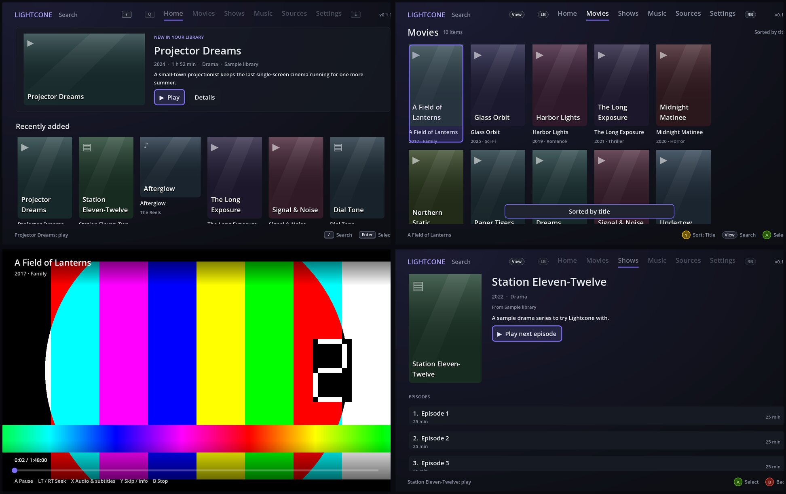
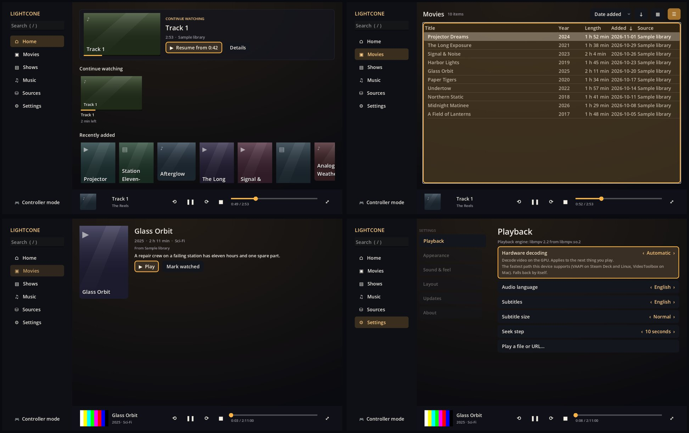

# Lightcone

A controller-first media hub for Steam Deck (SteamOS, Bazzite), TVs and desktops. Movies, shows and
music from your own folders and from Jellyfin or Plex, played through libmpv. Named after the cone
of light a cinema projector throws across the room.



Two UI modes, with the same features in each:

- **Controller mode** is a 10-foot layout. A plays, B goes back, the bumpers switch sections and the triggers seek. There is no cursor, but touch and mouse still work. Search uses Steam's on-screen keyboard in Game Mode.
- **Desktop mode** is a traditional window. It has a sidebar, a grid/list toggle, a sortable table, a mini player and keyboard shortcuts.

The mode is picked automatically (Controller in Game Mode / Big Picture, Desktop elsewhere). You can switch it any time from Settings → Layout or the sidebar.



## Status

**0.2.0, Phase 2 (preview).** The app shell, both UI modes, the player and the settings are in place, and every release carries its own playback engine.

- The playback engine works end to end and needs nothing installed. CI builds libmpv from pinned sources for each OS, plays the built-in sample library (generated test patterns and tones) through it and takes screenshots.
- Real sources are not wired up yet.

| Phase | What |
|---|---|
| 1 ✅ | Scaffold: Core/Host/Playback/CLI/App, both UI modes, libmpv player (GL texture path, software fallback), settings, self-update, Steam shortcut, CI with UI smoke tests, Linux/Windows/macOS builds |
| 2 ✅ | libmpv bundled in every release (slim Steam Runtime build for Linux, pinned DLL for Windows, dylibs in the .app), Deck hardware-decoding bench, PGS check |
| 3 | Local folders (SD cards and network shares included) with TMDB / MusicBrainz metadata and artwork |
| 4 | Plex (done in 0.3.0), then Jellyfin: sign in, libraries, continue watching, progress sync, intro/credits markers |
| 5 | Music: queue, shuffle, gapless, album/artist views, background playback |
| later | DLNA / UPnP discovery |

## Install

Download the latest release from [Releases](https://github.com/TheRoben-Dev/Lightcone/releases).

**Linux / Steam Deck (Desktop Mode):**

```sh
tar xzf Lightcone-linux-x86_64.tar.gz && ./Lightcone/install.sh
```

This installs to `~/Applications/Lightcone`, adds a menu entry and adds a Steam shortcut with art. Use `--restart-steam` if Steam is open.

Playback needs nothing else installed: the build carries its own libmpv. `~/Applications/Lightcone/lightcone probe` shows the engine and the codecs it decodes.

**Windows:** unzip `Lightcone-windows-x86_64.zip` and double-click **Install Lightcone.cmd**. It installs per user with no admin rights, and adds a Start menu entry and an Apps & features entry.

**macOS (Apple silicon and Intel):** unzip `Lightcone-macos-universal.zip` and move `Lightcone.app` to Applications.

- The app is signed ad hoc, not notarized, so on first launch right-click it and choose **Open**. Or run `xattr -dr com.apple.quarantine /Applications/Lightcone.app`.

Updates install from inside the app (Settings → Updates) and keep one previous version to roll back to.

## Playback

Lightcone embeds libmpv through mpv's render API. Video is drawn into a Godot texture on Godot's own OpenGL context, so the UI sits on top.

- **GL context:** EGL on Linux (`opengl3_es`) for zero-copy VA-API on AMD, CGL on macOS (VideoToolbox), WGL on Windows.
- **Software fallback:** `--video-sw` or `LIGHTCONE_VIDEO_SW=1`.
- **Benchmark:** `Lightcone --bench[=<file>]` plays for 30 s and writes `bench-*.txt` next to the logs. It records the render path, hwdec in use, dropped frames, fps and the subtitle tracks found. See [docs/bench.md](docs/bench.md) for the Steam Deck and Mac checklist.
- **Design:** [docs/video-playback-spike.md](docs/video-playback-spike.md).

Controls in the player:

| | Controller | Keyboard / mouse |
|---|---|---|
| Play / pause | A | Space, click |
| Seek | LT / RT, d-pad ← → | J / L, ← → |
| Audio & subtitles | X or Start | A, button |
| Skip intro / info | Y | button |
| Back (video stops, music keeps playing) | B | Esc |
| Full screen | (always) | F, double-click |

## Build

Requirements: .NET 8 SDK, [Godot 4.7.2 .NET](https://godotengine.org/download), and a libmpv: either the system's (`libmpv2` on Debian/Ubuntu, `mpv-libs` on Fedora, `brew install mpv`), or the one releases ship, built with `tools/libmpv/build.sh <out>` and picked up through `LIGHTCONE_LIBMPV=<out>/libmpv.so.2`.

```sh
dotnet build Lightcone.sln            # core, host, playback, CLI (warnings are errors)
dotnet test Lightcone.sln             # unit tests (+ a real libmpv playback test when libmpv is present)
dotnet run --project src/Lightcone.Cli -- probe
godot --path src/Lightcone.App -- --demo   # the app, with the sample library
tools/smoke/run-ui-smoke.sh "$(command -v godot)" /tmp/shots   # UI smoke test under Xvfb
```

Layout: see [docs/architecture.md](docs/architecture.md).

## License

See [LICENSE](LICENSE).
