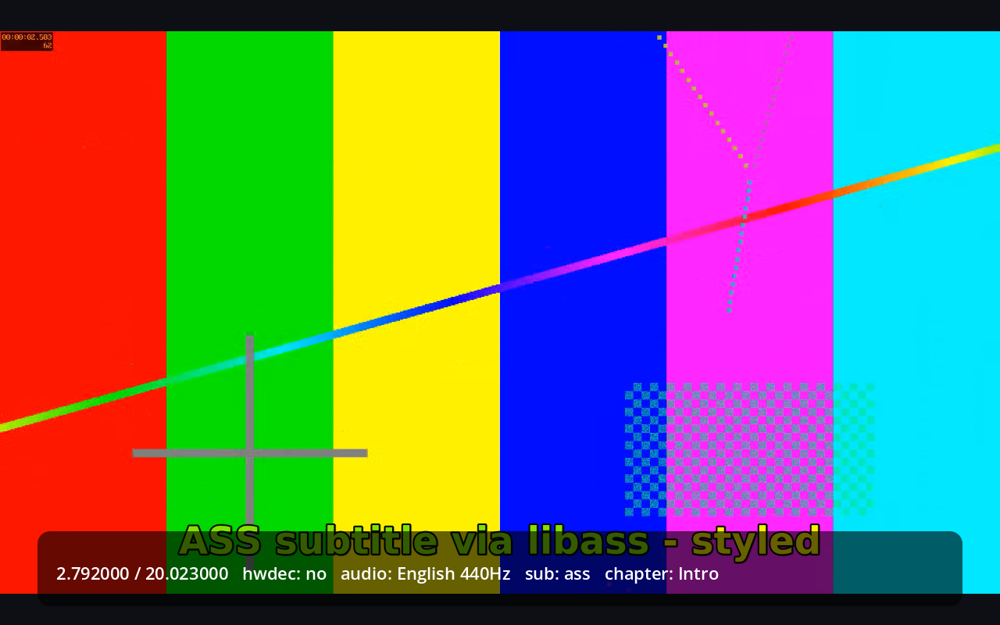

# Video playback spike

Goal: pick how Lightcone plays video before any UI is built on top of it. Target: Godot 4.7 (.NET),
SteamOS/Bazzite in Game Mode (gamescope) and Desktop Mode, desktop Linux, Windows.
Needs: hardware decoding on the Deck's AMD APU, SRT/ASS/PGS subtitles, audio track switching,
resume, intro/credits skip, and a Godot-drawn 10-foot OSD over the picture.

## Recommendation

**libmpv, rendering through its OpenGL render API into a Godot texture, from mpv's own GL context
that shares textures with Godot's. Godot runs the Compatibility renderer on the GLES 3 / EGL
driver (`opengl3_es`).** Godot owns the window, input and every pixel of UI; mpv owns decoding,
audio, subtitles (libass) and A/V sync.

Why:

- One window. Nothing to juggle under gamescope, and the OSD, track pickers and "Skip intro"
  button are ordinary Godot controls drawn over the video, so Controller and Desktop mode share them.
- mpv already does everything on the feature list: hwdec (VA-API on Linux, D3D11VA on Windows),
  ASS/SRT/PGS, track switching (`aid`/`sid`), `start=` for resume, chapters, `ab-loop`,
  gapless audio, network streams (Jellyfin/Plex direct play URLs with headers).
- EGL is the path where mpv's VA-API interop is zero-copy (`vaapi` via EGL dmabuf import). With the
  GLX driver mpv refuses VA-API interop and falls back to copy-back.
- Luma already runs the Compatibility renderer, so the look and theme code carries over unchanged.

## What was built and tested

`spike/video-playback/` is a minimal Godot 4.7.2 C# project (≈350 lines, no packages):

- `Mpv.cs`: P/Invoke for the libmpv client API and render API, plus the GL/EGL entry points.
- `Main.cs`: creates two Godot `ImageTexture`s, gets their GL names with
  `RenderingServer.TextureGetNativeHandle`, creates an EGL context in Godot's share group on a
  dedicated `mpv-render` thread, attaches the textures to FBOs there and lets mpv render into them
  (double buffered, `glFinish` before publishing a frame). A Godot panel is drawn on top as the OSD.
- A scripted run takes 5 screenshots: ASS subs, audio track 2 + SRT subs, seek +5 s (trigger seek),
  chapter jump (skip intro), reload with `start=15` (resume). `tools/spike/run-spike.sh` checks them.

Test clip (`tools/spike/make-test-clip.sh`): 1080p24 HEVC Main10 and H.264, two AAC tracks
(eng/swe), ASS + SRT subs, Intro/Episode chapters.

Run here: Ubuntu 24.04, Xvfb, Mesa llvmpipe (software GL), libmpv 0.37 (client API 2.2).

| Check | Result |
|---|---|
| mpv renders into a Godot texture, correct orientation (`flip_y = 0`) | ✓ |
| Godot UI composited over video | ✓ |
| ASS styled subs (libass) and SRT | ✓ |
| Audio track switch at runtime (`aid=2`) | ✓ |
| Relative seek, chapter jump, resume via `start=` | ✓ (t = 11.4 s, 5.1 s, 16.5 s) |
| Separate shared EGL context, H.264, 4 of 4 runs, 20 of 20 shots | ✓ |
| HEVC 10-bit, software decode, on llvmpipe GLES | Flaky: some runs lose chroma. llvmpipe's 16-bit GLES uploads; not the path the Deck uses (see below) |
| VA-API hwdec | Not testable here (no GPU). mpv loaded the `vaapi` driver with "using EGL dmabuf interop" under `opengl3_es`, and refused it under GLX |

Screenshots: [`docs/spike-shots/`](spike-shots/).

## What went wrong on the way (and decides the design)

1. **Rendering in Godot's own GL context is not reliable.** Calling `mpv_render_context_render`
   from `RenderingServer.CallOnRenderThread` works sometimes and gives black or chroma-less (green)
   frames other times. Godot's renderer binds sampler objects to texture units and caches GL state,
   and mpv also assumes state. Unbinding samplers around the call helped but did not fix it.
   **Fix: mpv gets its own EGL context** in Godot's share group (`eglCreateContext` with Godot's
   context as `share_context`, surfaceless). Textures are shared, state is not.
2. **Cross-context visibility needs double buffering.** With one shared texture Godot kept showing
   stale/black content, because GL only guarantees another context's writes after a re-bind.
   Two textures that swap each frame force the re-bind. Production version: `glFenceSync` in mpv's
   context, `glWaitSync` before Godot samples, instead of `glFinish`.
3. **`fbo-format=rgba16f`** (mpv's default intermediate) was black on llvmpipe; `rgba8` works.
   Real GPUs handle rgba16f. Keep it configurable and fall back to rgba8 when the renderer
   reports itself as software.

## Options considered

| Option | Verdict |
|---|---|
| **libmpv render API (GL) → Godot texture, shared EGL context** | **Chosen.** Full feature set, zero-copy hwdec on EGL, single window. Cost: native interop code (~500 lines in production) and bundling libmpv |
| libmpv render API in Godot's own context | Rejected: GL state clashes (above) |
| libmpv software render API (`MPV_RENDER_API_TYPE_SW`) → `ImageTexture.Update` | Fallback only. Works with any Godot renderer, but CPU colour conversion + a 8 MB upload per 1080p frame; too heavy for 4K and for Deck battery |
| mpv as a separate process/window (`--wid`, JSON IPC) | Rejected: Godot can't host a child window; under gamescope a second window steals focus and the Godot OSD can't sit on top |
| Godot `VideoStreamPlayer` | Rejected: Theora only |
| FFmpeg GDExtensions (e.g. EIRTeam.FFmpeg) | Rejected: no libass subtitles, limited track control, own A/V sync, extra C++ build to maintain |
| LibVLCSharp (used in Savefile/Cnema) | Rejected for this app: libVLC 3 video callbacks are CPU copies only, no GL texture sharing (libVLC 4 has it but isn't stable) |

## Platform notes and open risks

- **Steam Deck hwdec**: VCN 3 decodes H.264, HEVC Main10, VP9 and AV1. Needs `hwdec=vaapi`
  (or `auto-safe`) with Godot on `opengl3_es`, and the X11 display passed to mpv
  (`MPV_RENDER_PARAM_X11_DISPLAY` from `DisplayServer.WindowGetNativeHandle`) or `WL_DISPLAY` on
  Wayland. **First thing to verify on a real Deck**, in Game Mode and Desktop Mode, with a 4K HEVC
  10-bit file: `hwdec-current` must read `vaapi`, and CPU use should stay low.
- **Windows**: Godot's Compatibility renderer uses WGL by default; `opengl3_angle` gives EGL on
  D3D11, which keeps one code path. mpv's ANGLE interop for zero-copy D3D11VA depends on the libmpv
  build, so the safe default is `hwdec=d3d11va-copy`/`auto-copy` (copy-back is cheap on desktop
  GPUs). WGL shared contexts (`wglCreateContextAttribsARB` with a share context) are the fallback.
- **Packaging libmpv**: SteamOS doesn't ship it. Linux tarball bundles a CI-built `libmpv.so.2`
  (mpv + FFmpeg + libass + libplacebo, LGPL configuration, `-Dgpl=false`). Windows bundles
  `libmpv-2.dll` from a pinned LGPL build. Both are dynamically loaded, which keeps the app MIT.
  Expect ~40–60 MB added per platform.
- **PGS subs, HDR, Dolby Vision**: PGS is rendered by mpv like any bitmap sub. HDR is tone-mapped
  to SDR by mpv (the Deck LCD is SDR; OLED HDR output from a Godot window isn't on the table).
- **Battery**: Godot stays in `low_processor_mode`; mpv's update callback triggers redraws only
  when a new frame is ready, so idle UI and paused video cost almost nothing.

## Next step if accepted

Phase 1: solution layout (`Lightcone.Core` / `Lightcone.Host` / `Lightcone.Playback` / `Lightcone.App`,
same split as Luma), the production `MpvPlayer` (fence sync, track/chapter model, resume store,
error handling), libmpv bundling in CI, and the base UI shell with Controller and Desktop modes.
